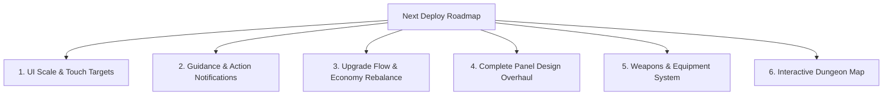

# Dungeon Cleaners — Deployment Report & Next Deploy Roadmap

**Date:** November 13, 2026  
**Engine:** Unity 6 (6000.6.4f1)  
**Target Platform:** Android (ARM64 / IL2CPP / API 24+) & PC  
**Project Path:** `c:\Users\ermek\ForUnity\Dungeon_Cleners`

---

## Part 1: Today's Deployment Summary (What Was Delivered & Fixed)

### 1. Critical Bug Fixes & Stability
- **`NullReferenceException` at `EnsureRouteChoiceModal`:**
  - *Cause:* `nextRoom.routeOptionA` and `routeOptionB` were unassigned (`null`) for starting and boss rooms in `DungeonGenerator.cs`, leading to null pointer exceptions when accessing accent colors or titles during card generation.
  - *Fix:* Enforced full initialization of `routeOptionA` and `routeOptionB` across all rooms in `DungeonGenerator.cs`, and added defensive fallback generation in `EnsureRouteChoiceModal` so missing options can never crash the game.
- **Unclickable UI & Modal Overlap:**
  - *Cause:* When Room 1 cleared, `RouteChoiceModal` spawned directly on top of `RoomUpgradeModal`. Because `RouteChoiceModal` created a full-screen raycast-blocking background image (`anchorMin=0, anchorMax=1`), and then threw an unhandled exception, it blocked all pointer/touch events to the scene.
  - *Fix:* Synchronized the coroutine lifecycle in `DungeonCombatController.cs`: `PresentRoomUpgradeChoice` must completely dismiss and deactivate `roomUpgradeModal` before `PresentRouteChoiceModal` begins.
- **Missing / Empty Proceed Button Text ("Label" Transform Error):**
  - *Cause:* Buttons created with `new GameObject("Label")` defaulted to a plain `Transform`, failing when Unity scripts subsequently accessed `GetComponent<RectTransform>()` or `AddComponent<RectTransform>()`, preventing TextMeshProUGUI from rendering.
  - *Fix:* Ensured all UI GameObjects instantiate with `typeof(RectTransform)`. Explicitly bound `proceedTmp.text`, anchored RectTransforms edge-to-edge, and assigned fallback font references.
- **Top HUD Level & Room Header Truncation:**
  - *Cause:* The `Room` label in `Combat.unity` had a constrained width of only 340px at `y = -8`, causing "Room 1/5 • ENTRANCE CHAMBER" to word-wrap into 4-5 vertical lines bleeding across the playfield and over dungeon wall bricks.
  - *Fix:* Expanded `RoomLabel` to 750px width at `y = -22` with `TextWrappingModes.NoWrap` and `TextOverflowModes.Overflow`, centering the header cleanly above the arena.
- **NPC & Boss Sprite Dissolving / Vanishing:**
  - *Cause:* Sorting order formula (`100 - y*10`) caused units at higher Y-coordinates to drop behind floor/wall tiles (`<= 0`). Conflicting `DieEffect` coroutines also collided with boss climax sequences.
  - *Fix:* Updated sorting order to `2000 - y*10`, hardened `SpriteCache` with unified `LoadHeroOrBossSprite`, and isolated death effect coroutines.

### 2. Android APK Build Pipeline & Package Fixes
- **`AndroidApkBuilder.cs` Pipeline:**
  - Built automated pipeline targeting `Builds/Android/DungeonCleaners_Test.apk` with IL2CPP scripting backend, ARM64 architecture, Android API Level 24+ minimum, Landscape-left orientation, and LZ4 compression.
- **Fixed 14 Third-Party Package Compiler Errors:**
  - *Cause:* The external package `com.scenarioinc.scenario` had unconstrained platform settings in `RestSharp.Unity.asmdef` and `Needle.Deeplink.Sample.asmdef` (`"includePlatforms": []`), causing Unity's Player build to attempt compiling editor-only scripts (`using UnityEditor;`) into the Android runtime.
  - *Fix:* Constrained both `.asmdef` files to `"Editor"` and added `FixPackageCacheEditorAsmdefs()` into `AndroidApkBuilder.cs` to auto-patch cached packages before build execution.
- **`MobileSafeArea.cs` Inset Adapter:**
  - Automatically adapts edge-anchored HUD elements to mobile display notches, camera punch-holes, and gesture navigation bars while keeping backdrops edge-to-edge.

### 3. Pixel-Art UI Theme Engine
- Created `DungeonUITheme.cs` and `DungeonUIThemeGenerator.cs` generating 9-slice sliced pixel-art assets (`ui_panel_frame.png`, `ui_card_frame.png`, `ui_btn_normal.png`, etc.) at 32 PPU with Point filtering and `SpriteSwap` button transitions.

---

## Part 2: Next Deploy Goals & Technical Architecture

### Goal 1: UI Scale-Up & Mobile Readability Overhaul
*Objective: Guarantee mobile touch ergonomics (>= 54px hitboxes) and high-visibility typography.*
- **Scale Factors:**
  - Button minimum height: increased from 40px to **54px - 64px**.
  - Modal card dimensions: scaled from 280x335 to **320x400**.
  - Font sizes: Header titles **24-28px**, body descriptions **16-18px**, button labels **16-18px Bold**.
- **Touch Margins:**
  - Increase horizontal spacing between cards (minimum 28px) to eliminate accidental multi-touches on mobile screens.
  - Scale up top HUD buttons (`Pause`, `x2 Speed`, `Repo`) to 68x54px with clear icon/text pairings.

### Goal 2: Guidance & Action Notification System ("Nudge / Pointer")
*Objective: Guide new players seamlessly through post-room choices and combat actions.*
- **Visual Nudge Indicators:**
  - **Pulsing Arrow / Hand Callout:** When a player has enough gold to buy an upgrade but hasn't clicked a card, a pulsing glowing chevron points to available cards.
  - **Glowing Confirm Prompt:** Once a card is selected, the Proceed/Confirm button pulses with a bright green border animation (`transform.localScale` oscillating between 1.0 and 1.06).
  - **Low Health / Revive Flash:** When a squad hero falls in combat, the bottom portrait flashes red and Kira's guide box prompts: *"Hero down! Use Tactical Revive in quick buffs!"*
- **Tactical Fixer Dialogue Integration:**
  - Non-intrusive notification pill anchored to the top-left explaining unfamiliar mechanics (investments, hazard rooms, elite modifiers) with an optional "Got it" tap-to-dismiss.

### Goal 3: Upgrade Flow Rebalance & Selection Limits
*Objective: Prevent runaway power spikes and create meaningful roguelite tactical decisions.*
- **Strict Pick Limitation:**
  - Replace confusing multi-purchase toggles with a standard roguelite rule: **Pick 1 Free Upgrade** per cleared room, OR spend gold to purchase a **Second Luxury Upgrade**.
- **Reroll Economy:**
  - 1 free reroll per floor; subsequent rerolls cost scaling gold (`35G -> 70G -> 120G`).
- **Category Variety Pacing:**
  - Slot 1: **Offensive / Skill Upgrade** (ATK, Crit, Cooldown).
  - Slot 2: **Defensive / Survival Upgrade** (Max HP, Armor, Regeneration, Dodge).
  - Slot 3: **Economic / Vault Stake** (Gold bounty, interest investment, mercenary bounty).

### Goal 4: Complete Visual Design Overhaul of All Panels & Modals
*Objective: Ensure 100% aesthetic consistency with dark-stone pixel-art frames across every game state.*
- **Panels to Unify:**
  1. **Main Menu & Pause Screen:** Dark-slate stone slabs with glowing cyan neon runes.
  2. **Formation / Repositioning Grid:** High-contrast 3x3 tactical battle grid with animated selection borders.
  3. **Tactical Supplies Modal (Room Clear):** 3-pillar card layout with distinct color-coded rarity banners (Common: Blue, Rare: Amber, Epic: Purple).
  4. **Route Choice Modal:** Dual passage banners (North/South vs Direct/East) with hazard warning icons.
  5. **Post-Boss Mercenary Market:** 2-column recruit/squad exchange interface with stat comparison badges.
  6. **Game Over & Victory Screens:** Stylized death ledger and victorious floor summary with run statistics.

### Goal 5: Weapons & Equipment Subsystem (Swords, Staves, Bows)
*Objective: Deepen build diversity with equippable weapon drops and in-game weapon graphics.*
- **Data Architecture:**
  - Create `WeaponData.cs` (ScriptableObject) and `WeaponInstance.cs`:
    * `WeaponType`: Sword (Melee/Slash), Bow (Ranged/Piercing), Staff (Arcane/Splash), Dagger (Rapid/Crit).
    * `Stats`: Base Damage, Attack Speed multiplier, Range, Critical Chance, Knockback force.
    * `Special Effect`: Poison on hit, Cleave (hits 2 adjacent targets), Shock stun.
- **Visual Integration:**
  - Attach child weapon sprite (`WeaponAnchor`) to `HeroCombatAgent`, rotating and thrusting in sync with attack lunges.
- **Acquisition:**
  - Drops from Elite Room champions and Boss clearance chests.
  - Equippable in Hero Detail Panel or during the post-room supply phase.

### Goal 6: Interactive Dungeon Map & Node Exploration
*Objective: Provide a visual floor map replacing linear text routes with a branching node tree.*
- **Map Representation:**
  - Slay-the-Spire / FTL style visual floor tree: `Entrance -> Room 2 (Combat / Elite) -> Room 3 (Shop / Shrine) -> Boss Chamber`.
  - Nodes display preview icons: Crossed Swords (Combat), Skull (Elite), Coin Bag (Treasure/Shop), Campfire (Rest/Heal).
- **Interactive Navigation:**
  - Player taps adjacent connected nodes on the map to navigate their cleaners squad.
  - Fog of war hides deep room modifiers until nearby corridors are explored.

---

## Part 3: Verification & Build Deliverable

- **Primary Android APK:** `Builds/Android/DungeonCleaners_Test.apk`
- **Build Trigger:** Top menu **Tools > Dungeon Cleaners > Build Android APK**

